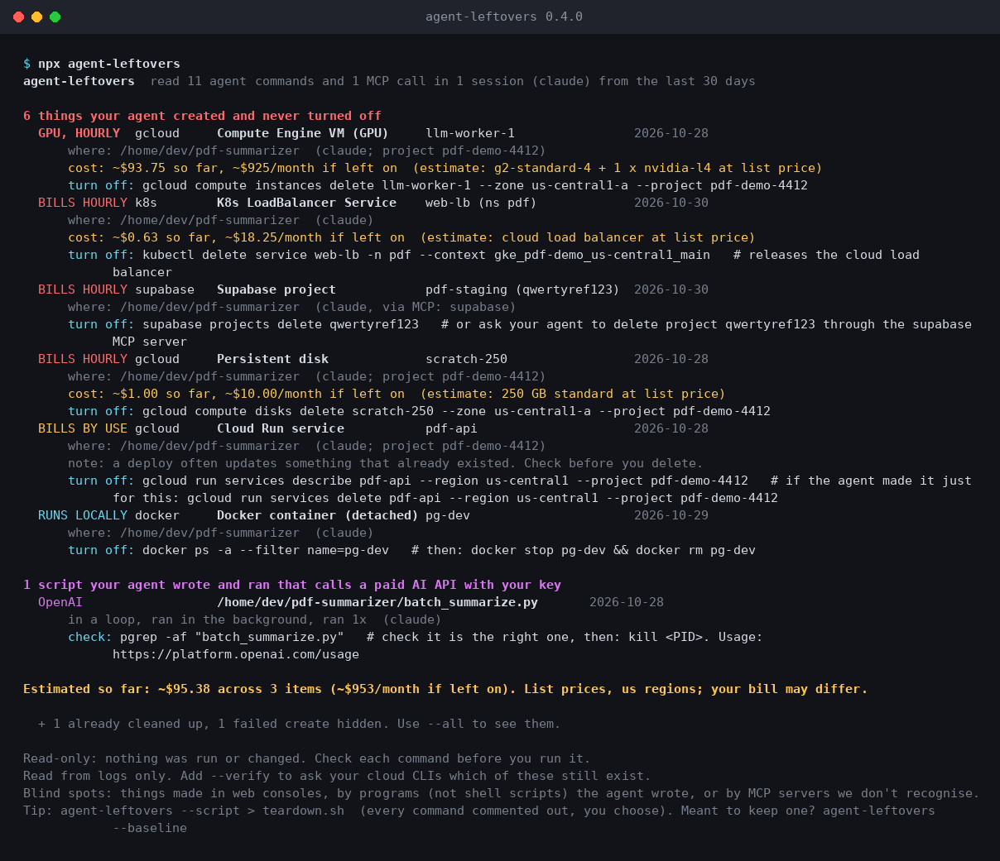

# agent-leftovers

[](https://github.com/ApahSaroj/agent-leftovers/actions/workflows/test.yml)


**See every cloud resource your AI coding agent left running, what it has cost so far, and the command to turn each off.**

```
npx github:ApahSaroj/agent-leftovers
```

Node 18+. Nothing to install; it reads your local agent logs, prints a report and exits.
It is not on npm yet; once it is, `npx agent-leftovers` will work too.



<sub>Real output, from a synthetic session log made by `node demo/make-demo.js`. No real account was used.</sub>

## Why

Claude Code, Codex, Gemini CLI and Copilot CLI happily run `gcloud compute instances create`,
`kubectl apply`, `docker run -d` or a Supabase MCP `create_project` while finishing your task.
The session ends; the GPU box, the load balancer and the `nohup` script calling a paid API keep going.

agent-leftovers reads the session logs those agents already keep on your machine and lists:

- **what the agent created and never deleted**: VMs (GPU flagged), disks, IPs, databases, clusters,
  buckets, functions, deploys, Kubernetes load balancers and volumes, MCP-created projects
- **what keeps running locally**: detached Docker containers and Compose stacks, `nohup` / `&`
  background processes, ngrok and cloudflared tunnels
- **agent-written scripts that call a paid AI API with your key**, including ones left in the background
- **a rough cost so far** for things that bill by the hour (list prices, clearly marked as an estimate)
- **what still bills after a delete**: disks kept when a VM was deleted, Elastic IPs after a terminate,
  the disk, NIC and public IP an Azure VM leaves behind
- **expiry and session tags** on what the agent made, so past-expiry items go to the top
- **a teardown command for each**, with zone, region, project and profile filled in

It is **read-only**. By default it runs nothing and sends nothing anywhere. `--verify` asks your own
CLIs which items still exist, and `--sweep` lists anything past its expiry tag, using read-only
describe/list calls only.

## Safe teardowns, on purpose

A tool that tells you what to delete must not cause the next incident:

- **Deploys and applies are not treated as new.** `terraform apply`, `netlify deploy`, `vercel --prod`,
  `wrangler deploy`, `fly deploy`, `gcloud run deploy`, `cdk deploy` usually update something that
  existed before the agent. Those get a look-first command (`terraform state list`, then
  `destroy -target=`; `wrangler rollback`; `vercel ls`) and a clear note. Never a blind `destroy`.
- **No prompt is skipped.** No `--quiet`, `--yes` or `--skip-final-snapshot`, and `--force` only in
  one place: `fly machine destroy <ID> --force`, because Fly refuses to destroy a running machine
  without it (you still pick the machine ID from `fly machine list` first). Buckets are never
  force-deleted (`aws s3 rb` without `--force`). A hint may name such a flag (`aws s3 rb --force`,
  `--skip-final-cluster-snapshot`, `doctl ... --dangerous`) as your choice; it is never in the
  command itself. RDS and Redshift deletes keep a final snapshot. `az group create` succeeds on existing groups, so it says check first.
- **Commands are printed, never run.** `--script` writes every line commented out, and a name holding
  a newline or terminal escape code can't break out of the comment (control characters are stripped).

## Works with

| Agent | Logs read |
|---|---|
| Claude Code | `~/.claude/projects` (or `$CLAUDE_CONFIG_DIR`), also `~/.config/claude/projects`; Bash and PowerShell tool calls |
| Codex CLI | `~/.codex/sessions`, `archived_sessions` (or `$CODEX_HOME`), incl. `.jsonl.zst` on Node 22.15+; Windows `powershell -Command` / `cmd /c` calls |
| Gemini CLI | `~/.gemini/tmp/*/chats`, incl. subagent chats (or `$GEMINI_CLI_HOME`) |
| GitHub Copilot CLI | `~/.copilot/session-state/*/events.jsonl` (or `$COPILOT_HOME`) |

On Windows it also reads the home folders inside WSL. It also looks in Claude Desktop's agent-mode
folder (`local-agent-mode-sessions`) when it exists; that location is taken from a third-party
source and has not been checked on a real Desktop install.

A command the agent stopped waiting for (a timeout or an interrupt) is still listed, marked
"uncertain": the cloud operation usually carries on after the local CLI is killed. A delete that
timed out counts only as "maybe". Background runs started through the tool itself
(`run_in_background`, `is_background`, Copilot `detach`) are listed like `nohup` ones. The same tool
call found in two files (a set-aside transcript, a `.jsonl` beside its `.jsonl.zst`) is counted once.

## Claude Code plugin: a heads-up at the start of every session

```
/plugin marketplace add ApahSaroj/agent-leftovers
/plugin install agent-leftovers@agent-leftovers
```

At session start, Claude is told (in a few lines) what earlier sessions left running, so it can
mention it before you start new work. Nothing is shown when all is clear. `/agent-leftovers:leftovers`
runs the full report. Runs locally with the bundled code; no npm or network needed.

## What it spots

- **Google Cloud:** VMs, disks, static IPs, Cloud SQL, GKE and its node pools, Cloud TPU VMs, Vertex AI Workbench instances and endpoint deployments, Memorystore, Cloud Run, Cloud Functions, buckets, App Engine, enabled APIs
- **AWS:** EC2, EBS, Elastic IPs, NAT gateways, ALB/NLB, interface VPC endpoints, RDS and Aurora clusters, S3, Lambda, EKS/eksctl and eksctl node groups, ElastiCache (clusters, replication groups, serverless), OpenSearch domains and Serverless collections, Redshift clusters and Serverless workgroups, SageMaker endpoints and notebook instances, Bedrock provisioned throughput, Lightsail instances, ECS, DynamoDB, CloudFormation (`deploy`, `create-stack`), CDK, SAM
- **Azure:** resource groups, VMs, VM scale sets, AKS and AKS node pools, App Service, Container Apps, Container Instances, Azure ML compute, Azure OpenAI / AI Services accounts and deployments, Cache for Redis, Cosmos DB, SQL servers and databases, Postgres/MySQL
- **DigitalOcean CLI:** `doctl` Droplets, managed databases, Kubernetes clusters
- **Cloudflare:** Workers, D1, R2, KV, Queues, Pages
- **Kubernetes:** `Service type: LoadBalancer`, `Ingress`, `Gateway`, `PersistentVolumeClaim` from the manifests behind `kubectl apply -f` (files, folders, heredocs), `kubectl expose`, `kubectl patch`, `helm install`. Local clusters (kind, minikube, k3d, Docker Desktop) are skipped.
- **Local and exposure:** `docker run -d`, `podman run -d`, `docker compose up -d` and `docker-compose -f FILE up -d` (the teardown keeps `-p` and every `-f`), `nohup` / `setsid` / trailing `&`, `ssh -f` port-forward tunnels (`-R`, `-L`, `-D`), ngrok, cloudflared, `tailscale funnel`
- **Others:** Terraform/OpenTofu, Pulumi, Serverless, SST, Vercel, Netlify, Railway, Heroku, Supabase, Fly.io, Firebase, Modal, RunPod
- **MCP servers:** create/deploy calls on 24 cloud MCP servers (Supabase, Neon, Vercel, Cloudflare, AWS, Google Cloud, Azure, DigitalOcean, E2B, Fly.io, MongoDB Atlas and more), matched to their delete calls by resource type. A stop or pause is shown as "maybe", because disks and IPs keep billing.
- **Scripts the agent wrote and then ran** (`bash setup.sh`): the commands inside are read too.
- **Paid AI APIs** called from agent-written scripts: OpenAI, Anthropic, Gemini/Vertex, Mistral, OpenRouter, Replicate, ElevenLabs

It also follows the account a command ran in: `gcloud config set project`, `gcloud config set compute/zone|compute/region`, `export AWS_PROFILE`,
`--profile`, `--region` and `--project` (even before the subcommand) end up in the teardown and in `--verify`,
including `sam`, `cdk` and `eksctl` teardowns. Serverless keeps `--stage`/`--region`, Terraform keeps
`TF_WORKSPACE`. After `get-credentials` for GKE or AKS (or an EKS `--alias`), kubectl teardowns and
`--verify` use that cluster's `--context`; when the context can't be named, the teardown first asks
you to check `kubectl config current-context`, and `--verify` skips it.

A delete only clears the same resource: same zone or region, resource group, subscription, project,
profile, ECS cluster, Heroku app, Kubernetes context and namespace. The same name in two zones is
shown as two rows. A delete on a failed command line, inside a failed script, from another MCP
server, or on a `$VAR` name from another session counts only as "maybe".

Names and folders from the logs are never pasted into a teardown as shell code: a name with shell
characters becomes `<NAME>` (with a note), folders and odd flag values are single-quoted, and an odd
Kubernetes context or namespace becomes `<CONTEXT>` / `<NAMESPACE>` rather than being dropped. A
process lookup (`pgrep -af WORD`) only ever holds plain characters. An MCP
deployment teardown removes only that deployment (Vercel `--safe`), never the project or site.

Each teardown is one command you can paste, in bash, zsh, cmd.exe or Windows PowerShell 5.1: no
trailing `#` comment and no `&&`. What to check or run next is printed on its own `hint:` line, and a
folder is passed with the tool's own flag (`terraform -chdir=`, `docker compose --project-directory`,
`pulumi --cwd`) or shown as a separate `run in:` line. Run on Windows, the commands use double quotes,
and processes are found with `Get-CimInstance` (through `powershell -NoProfile -Command`) and stopped
with `taskkill`. In `--json` the parts are `teardown`, `teardownHint` and `runIn`; in `--script` hints
are `## hint:` lines, which stay comments when you remove the leading `# `.

## Options

```
--days N        how far back to look (default 30; no limit with --logs)
--project TEXT  only sessions whose folder contains TEXT
--logs PATH     read this log file or folder instead (repeatable)
--all           also show cleaned-up, ignored and failed items
--verify        ask your CLIs whether each leftover still exists (read-only, opt-in)
--script        print a teardown script, every line commented out
--json          machine-readable output (secrets masked)
--brief         a few lines, or nothing when all is clear (hooks, cron)
--exit-zero     exit 0 even when leftovers are found (for hooks that only read output on 0)
--sweep         list anything in gcloud, aws or az whose expiry tag has passed (opt-in)
--expired       only show things whose expires / ttl tag has passed
--tag KEY[=VAL] only show things with this tag or label, e.g. --tag session=abc123
--baseline      add everything listed now to ~/.agent-leftovers-ignore
--no-ignore     don't apply the ignore file
```

**Exit codes:** `0` nothing left running, `1` leftovers found, `2` error or bad option. The same with
`--brief`, `--script` and `--json`. `--exit-zero` turns `1` into `0`; the Claude Code plugin's
SessionStart hook uses it, because Claude Code only reads a SessionStart hook's output when it exits 0.
With `--expired` or `--tag`, an empty result says how many other items the filter hid.
Good for a daily cron or a pre-push hook.

**Meant to keep something?** Add it to `~/.agent-leftovers-ignore` (or `./.agent-leftovers-ignore`),
one pattern per line: a name, `rule:name`, or `provider:*`. Or run `--baseline` once to accept
everything currently listed.

## --verify

Logs say what the agent created, not whether it is still there today. `--verify` runs a read-only
check with the CLI you are already signed in to (`gcloud ... describe`, `aws ... describe-*`,
`kubectl get`, `helm status`, `docker ps`, `az group exists`, `wrangler d1 info`, `fly status`, and more):

- **still exists**: marked `[checked: still exists]`
- **gone**: drops out of the list and the exit code (see it with `--all`)
- **couldn't check** (not installed, signed out, offline, wrong context, no permission): stays listed with the reason. Only a real "not found" answer from that CLI counts as gone.

Safety: allow-listed read verbs only; names from the logs must look like real resource names and
can never start with `-`; every argument is checked against a strict character set; the CLI is
found on your PATH (never in the current folder); 20-second timeout per check.

## Orphans: the sneaky ones

Deleting the VM is not always the end of the bill. agent-leftovers follows the delete:

- **Google Cloud:** `instances delete --keep-disks=boot|data|all`, or a VM created with
  `--no-boot-disk-auto-delete`, leaves the boot disk behind. A `--create-disk` / `--disk` with
  `auto-delete=no` is a data disk, and is reported under its own `name=`. A static IP the VM used
  (`--address`) stays reserved and unattached, and an unused static IP bills at double the in-use rate.
- **AWS:** after `terminate-instances`, an Elastic IP the agent allocated stays allocated and keeps
  billing ($0.005/h, the same rate it paid while attached) until `release-address`. Auto-assigned
  public IPs are released on terminate. A volume launched with `DeleteOnTermination=false`, and any
  volume attached later with `attach-volume`, stays. When the log shows the instance ID, the terminate
  is matched to it exactly.
- **Azure:** `az vm delete` removes only the VM. The OS disk, data disks, NIC and public IP stay and
  keep billing. `--os-disk-delete-option Delete`, `--data-disk-delete-option Delete` and
  `--nic-delete-option Delete` on `az vm create` remove the disks and NIC. The CLI has no flag for the
  public IP, so it always stays unless you delete it or the resource group.

A later delete only clears one of these when the exact disk, volume, NIC or resource group matches.

## Session and expiry tags

Tag what your agent creates with a session ID and an expiry, and cleanup becomes a filter instead of
a hunt (idea from @AyCodeAI on X). agent-leftovers reads the tags on the create command
(`gcloud --labels`, `aws --tag-specifications` / `--tags`, `az --tags`):

```
gcloud compute instances create eval-gpu --labels=agent-session=abc123,expires=2026-11-07
```

- Expiry keys: `expires`, `expiry`, `expires-at`, `delete-after`, `ttl`. Values: `2026-11-07`
  (end of that day, UTC), `2026-11-07t18-30`, a unix time, or a ttl like `4h` / `3d` counted from
  creation. Impossible dates (`2026-13-45`, `2026-02-30`) and a bare year are reported as unreadable.
  GCP labels allow only lowercase letters, digits, `_` and `-`, so don't use ISO times with `T`, `:` or `Z` there.
- Session keys: `session`, `session-id`, `agent-session`.
- Past-expiry items go to the top, marked `EXPIRED 2 days ago`.
- `--expired` shows only those. `--tag agent-session=abc123` shows one session's resources.

## --sweep

`--sweep` goes further: it lists resources with your own signed-in CLIs (`gcloud compute
instances|disks|addresses list`, `aws resourcegroupstaggingapi get-resources`, `az resource list`)
and shows every one whose expiry tag has passed, **even if no agent log mentions it**. That also means
**it may not be your agent's**: a teammate, a script or the console may own it, so the output says to
check who owns each one first. Teardowns keep every prompt and a final RDS snapshot, and never
force-delete a bucket (versioned buckets: delete all object versions first). Read-only list calls
only, run the same safe way as `--verify`; it counts toward the exit code.

Limits:
- **AWS:** tagged resources only, in one Region (your default; set `AWS_REGION` to sweep another).
  Global services such as CloudFront and IAM show up only from `us-east-1`. There is no creation
  time, so a `ttl` like `4h` can't be resolved; use an absolute date on AWS.
- **Google Cloud:** the active `gcloud` project only, and it needs the Compute Engine API enabled.
  Static IPs can't take labels at creation; add them with `gcloud beta compute addresses update --update-labels`,
  so few will carry an expiry.
- **Azure:** the current subscription only.
- A CLI that times out is skipped for the rest of the sweep; output over 64 MB is reported, not parsed.

## How it compares

| | agent-leftovers | cloud-nuke / aws-nuke | account scanners (CleanCloud, Komiser) | ranwhat |
|---|---|---|---|---|
| Scope | only what your agent made | everything in the account | everything in the account | agent history |
| Action | prints a command per item | deletes | reports | flags changes |
| Needs cloud credentials | no (only for `--verify`) | yes | yes | no |
| Created-and-forgotten + teardown | yes | n/a | partly | no |

Use cloud-nuke for a sandbox account you want empty. Use agent-leftovers to find what your
agent made in an account you care about.

## Honest limits

- It sees shell commands, MCP calls and shell scripts the agent wrote and ran. Things made in a web
  console, or by a Python/JS program the agent wrote, are not in the log (paid-API scripts are covered).
- For `kubectl apply -f`, only manifests written or piped during the session are read.
- MCP support is pattern-based. A custom server with unusual tool names may be missed; please open an issue.
- Cost estimates use on-demand list prices for us regions and the time since creation. Your real bill
  depends on region, discounts, free tiers and when the thing was actually stopped.
- Cloud agents (Claude Code on the web, Codex cloud, GitHub Actions) don't leave logs on your laptop.
- Orphan detection covers kept disks, Elastic IPs, attached volumes and Azure VM parts. Snapshots,
  load balancers and disks left after a cluster delete are not followed yet.
  The log rarely shows instance IDs, so an AWS terminate is matched by ID only when the output was logged.
- Not checked against live accounts: the round-2 create/delete pairs (TPU, Workbench, Bedrock, Azure ML,
  Azure OpenAI, ALB, OpenSearch, Redshift, Lightsail, doctl, ACI, VMSS, Redis, Cosmos, SQL, tailscale)
  follow the official CLI references, and `--verify` has no check for them yet.
- Always read a teardown command before running it.

## Privacy

Everything happens on your machine. No telemetry, no dependencies. The only network traffic is what
your own CLIs do when you pass `--verify` or `--sweep`. See [SECURITY.md](SECURITY.md).

## Contributing

False positives and missed resources are the most useful reports:
[open an issue](https://github.com/ApahSaroj/agent-leftovers/issues/new/choose). See
[CONTRIBUTING.md](CONTRIBUTING.md). Much of this code was written with an AI coding agent and
reviewed by a human.

## License

MIT
